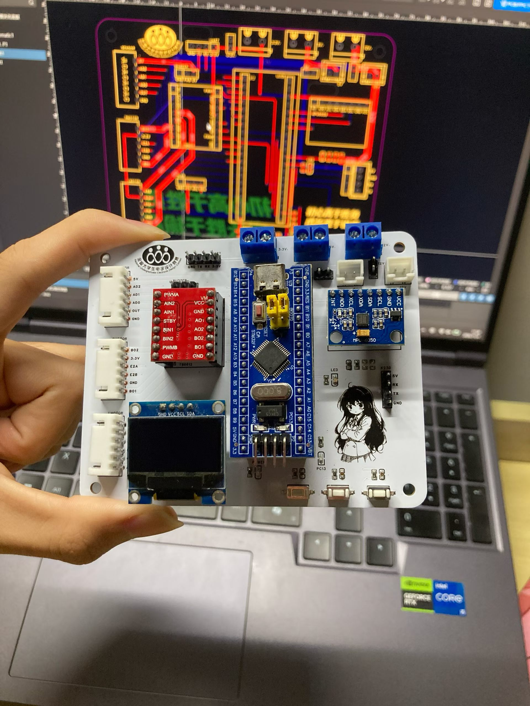

我觉得今天真的很倒霉呀。昨天以为的好消息结果只是自作多情了。。。然后今天心心念念画的板子到了，结果画错了很多接口，还把我的电机烧坏了，又需要再买两个电机。。。钱像水一样流走了呀(⁠╥⁠﹏⁠╥⁠)

虽然实现了基础的小车寻迹和视觉模块的激光追踪，但是这些是以前就知道肯定会做出来的东西。毕竟ai能很快做出来，我根本没有花太多心思。

由此产生过一个矛盾的想法。就是看过程的话，我感觉自己好像没有学到很多东西，就是消化速度赶不上ai辅助推进的进度。看结果的话，我好像也真的做出来东西了。ai到底算是时代进步带来的便利吗？噢噢我刚刚想明白了，是我的使用方法有问题，我后面会改正的。还是需要借助ai的，毕竟它只是一个工具，工具怎么使用关键还是在人。

最近和阳阳聊天很多呀，毕竟他在打智能车，也算是和我有差不多的关注方向吧。不过我突然发现我也不是那么没用，还是可以解决一些他问我的问题的，并不是那种网上说的那种什么都不会的yes工程师。

然后就是我今天刷到了一个抖音，就是一个人带着专科定位说自己是工科男。评论区说觉得至少要本科甚至更高才算。唉我无语了呀，因为我觉得我们平时也有在上工科的课程呀，虽然我感觉理论知识可能不足本科的1/10，但是也确实在学习工科的内容，不能被排除在外吧。大概是工科男被赋予了不同的意义吧(⁠☉⁠｡⁠☉⁠)⁠!

话说拿到板子的时候真的太开心，看着自己的作品变成现实真的特别有满足感呀(⁠≧⁠▽⁠≦⁠)希望自己能一直保持创造力，它带来了很多幸福感！

